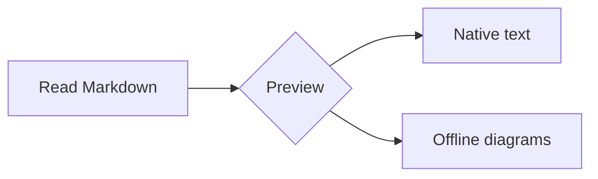
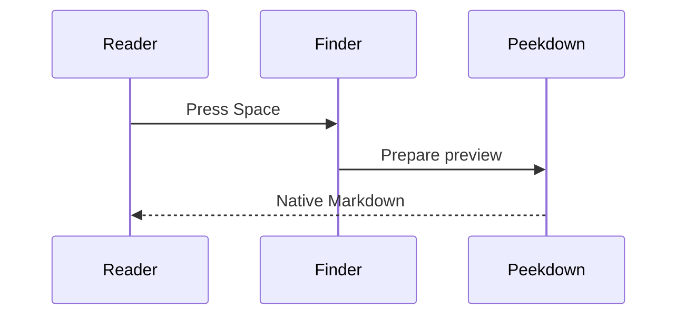
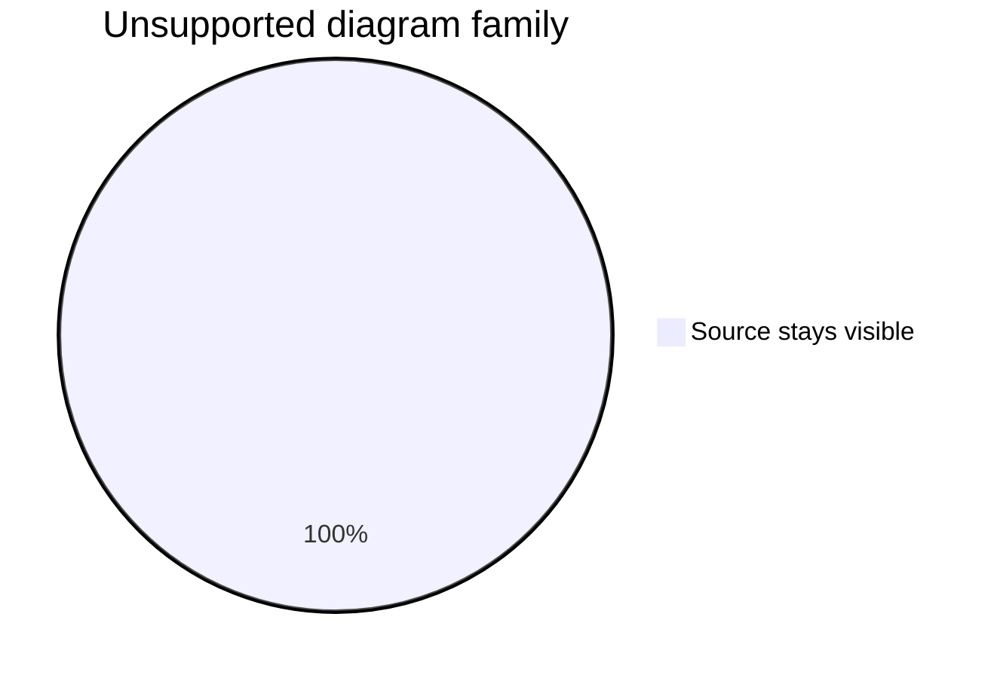

# Peekdown experiments

Open the Peekdown app to change text size, paragraph density, and code spacing.
Enable the two experimental switches, then close and reopen this preview.

## Mermaid flowchart



## Sequence diagram



## Display math

$$
x = \frac{-b \pm \sqrt{b^2-4ac}}{2a}
$$

\[
\sum_{i=1}^{n} i = \frac{n(n+1)}{2}
\]

Prices such as $5 or $10 remain ordinary text. Inline math is not enabled.

## Safe fallback



## Normal code

```swift
let preview = "Still native, still offline"
```

The experimental renderers are opt-in and limited to small inputs. Unsupported
syntax stays readable as source. Images are regenerated when a preview reopens.
